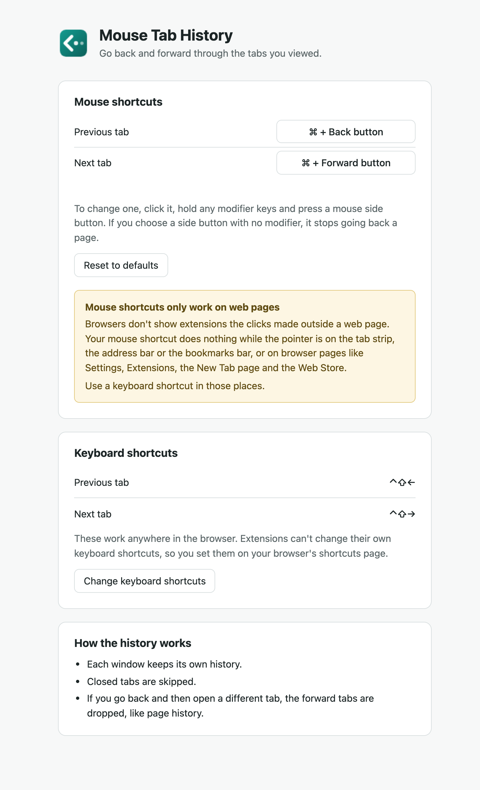

<p align="center">
  
</p>

<h1 align="center">Mouse Tab History</h1>

<p align="center">Back and forward buttons for your tabs, on your mouse.</p>

Your browser remembers the pages you visit in each tab, but it has no back button for the tabs themselves. Mouse Tab History adds one. Go from tab A to B to C, and "previous" takes you to B, then A. "Next" takes you forward again.

Most tab switchers cycle through recently used tabs. Mouse Tab History keeps them in a straight line, so pressing previous twice goes two tabs back.

## Shortcuts

| Action | Mouse (macOS) | Mouse (Windows, Linux) | Keyboard (macOS) | Keyboard (Windows, Linux) |
| --- | --- | --- | --- | --- |
| Previous tab | ⌘ + back button | Ctrl + back button | ⌃⇧← | Alt + Shift + ← |
| Next tab | ⌘ + forward button | Ctrl + forward button | ⌃⇧→ | Alt + Shift + → |

Click the Mouse Tab History icon in the toolbar to change the mouse shortcuts. You can use either side button with any mix of modifier keys.

Browsers manage extension keyboard shortcuts themselves, so you change those at `chrome://extensions/shortcuts` (`brave://extensions/shortcuts` in Brave). The settings page has a button that takes you there.

<p align="center">
  
</p>

## Install

Mouse Tab History isn't on the Chrome Web Store yet, so you load it from source.

1. Clone the repository:

   ```bash
   git clone https://github.com/Akiat/mouse-tab-history.git
   ```

2. Open `chrome://extensions` (`brave://extensions` in Brave) and turn on Developer mode.
3. Click Load unpacked and pick the `mouse-tab-history` folder.

The browser reads the extension from that folder, so keep it where it is.

## How the history works

- Each window keeps its own history.
- Closed tabs are skipped.
- If you go back and then open a different tab, the forward tabs are dropped, like page history.
- The history is cleared when the browser closes.

## Limits

Mouse shortcuts only work while the pointer is over a web page. Browsers don't show extensions the clicks made anywhere else, so nothing happens on the tab strip, the address bar or the bookmarks bar, or on browser pages like Settings, Extensions, the New Tab page and the Web Store.

Keyboard shortcuts work in all of those places. To use your mouse there too, a tool like Karabiner-Elements or BetterTouchTool can turn a mouse button into a keyboard shortcut.

Only the two side buttons can be used, because the others already open links and menus. If software such as Logi Options+ remaps your side buttons, the browser may never see them. Set them back to their default action for your browser.

Mouse Tab History has been tested on macOS with Brave and Chromium. It should work in other Chromium browsers and on Windows and Linux, but those are untested. Firefox and Safari aren't supported.

## Privacy

Mouse Tab History makes no network requests and doesn't keep the address or title of any page. The [privacy policy](PRIVACY.md) explains what it reads and stores in your browser, and why it asks for access to all websites.

## Development

There's no build step and there are no dependencies.

```bash
npm test          # run the unit tests
npm run package   # build mouse-tab-history.zip for the Chrome Web Store
```

- `history.js` holds the history logic.
- `background.js` tracks tab changes and moves through the history.
- `shortcuts.js` matches and stores mouse shortcuts.
- `content.js` runs in each page and detects them.
- `options.html`, `options.css` and `options.js` are the settings page.

## License

[MIT](LICENSE)
